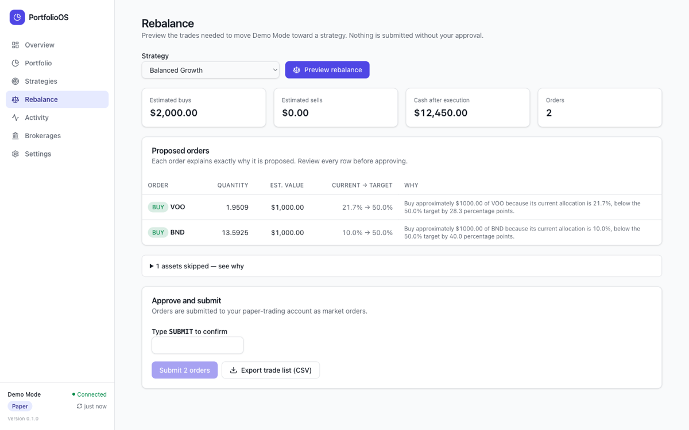
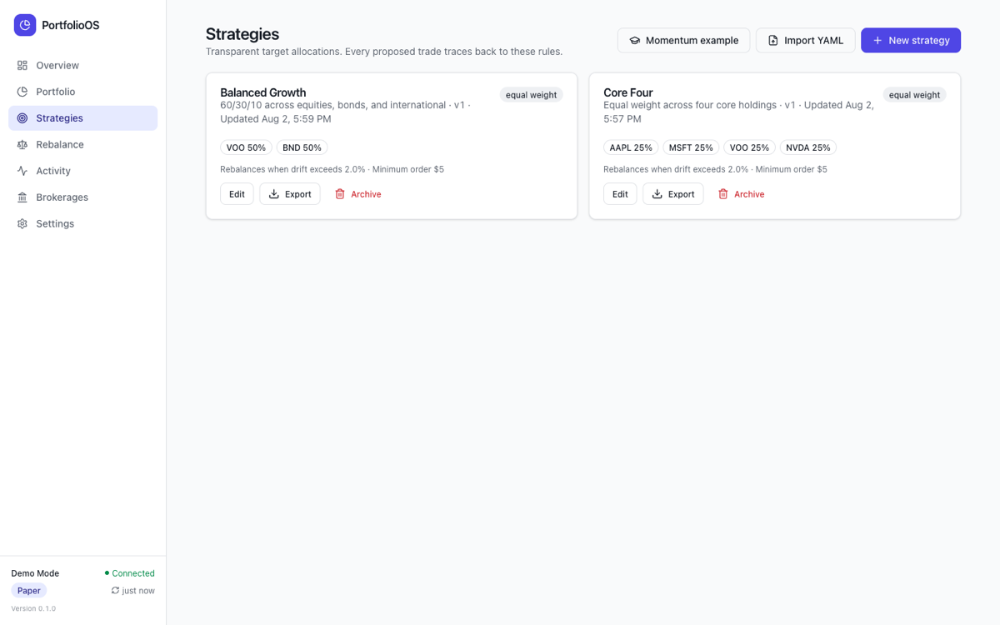
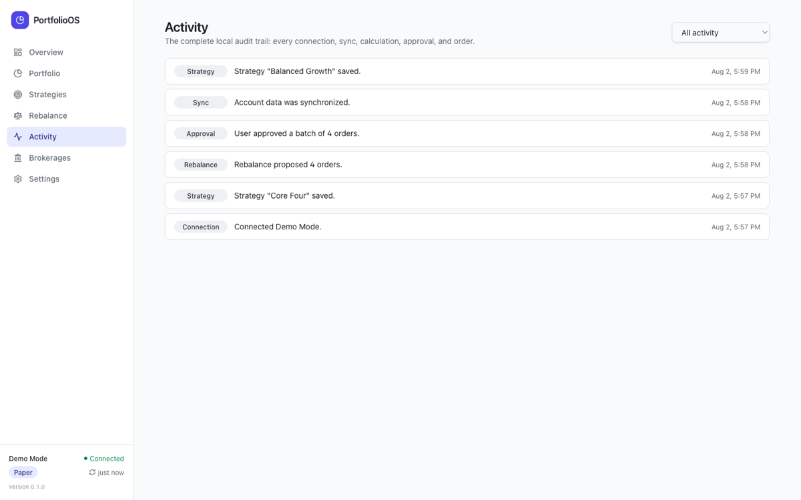
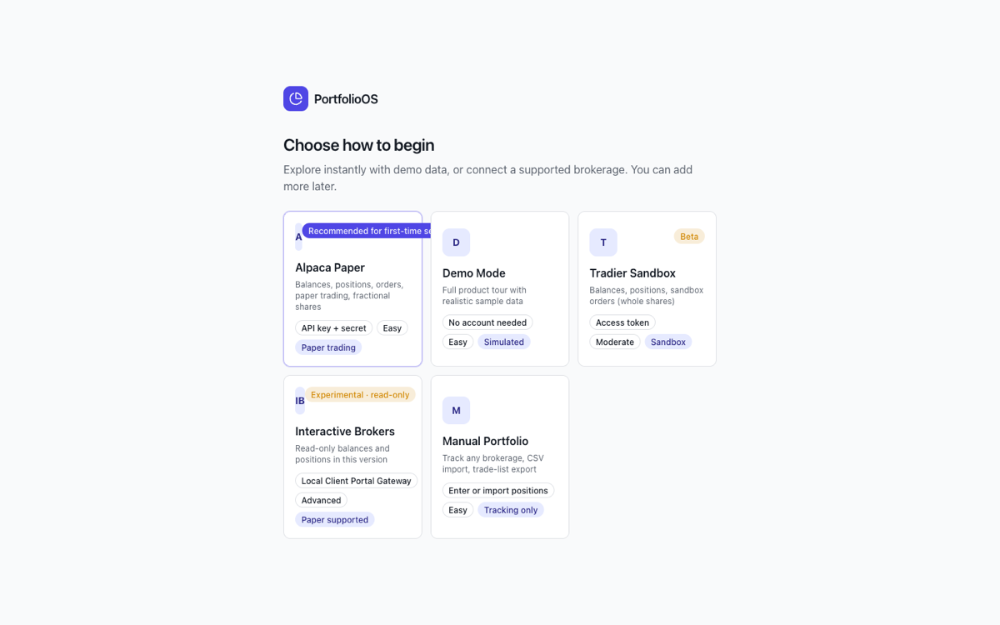
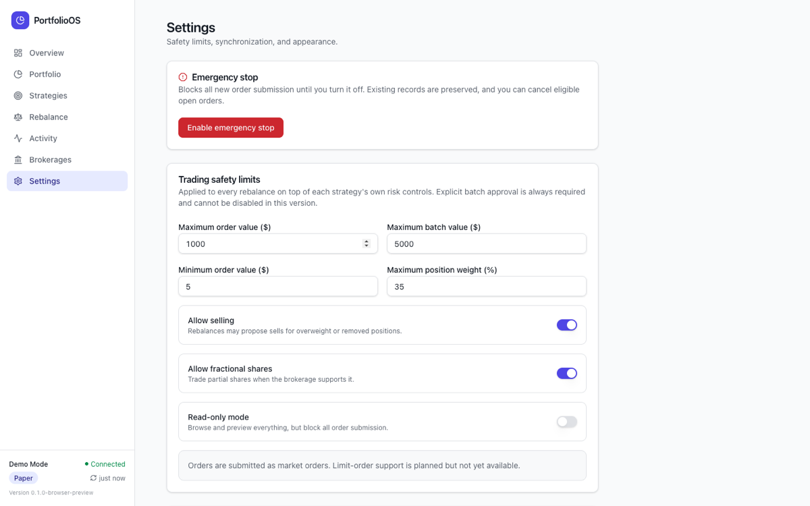

<p align="center">
  
</p>

<h1 align="center">PortfolioOS</h1>

<p align="center">
  <strong>Run a rules-based investment portfolio from your own computer — transparent strategies, previewed trades, nothing submitted without your approval.</strong>
</p>

<p align="center">
  <a href="LICENSE"></a>
  
  
  
</p>


> **Paper trading only.** PortfolioOS v0.1.0 connects exclusively to paper-trading and sandbox endpoints. There is no live-money mode. It is educational open-source software, not investment advice — see the [disclaimer](DISCLAIMER.md).

## What it does

1. **Connect a brokerage** — Alpaca paper trading, Tradier sandbox, a local IBKR gateway, a fully simulated Demo Mode, or a manually tracked portfolio.
2. **Define a strategy** as target weights — equal weight, custom allocation, or an educational momentum example. Strategies are readable YAML you can version, export, and share.
3. **Preview the rebalance.** The engine shows exactly which orders would move you toward your targets, explains *why* each one exists in plain English, and applies your safety limits.
4. **Approve and submit.** You type a confirmation before anything is sent. Track fills live and keep a complete local audit trail.

| Portfolio | Rebalance review |
| --- | --- |
|  |  |

| Strategies | Activity |
| --- | --- |
|  |  |

## Features

- **Transparent strategies** — every proposed order names the symbol, side, quantity, estimated value, current vs. target weight, drift, and a sentence explaining the trade.
- **Safety rails** — maximum order value, maximum batch value, maximum position weight, minimum order size, sell and fractional toggles, market-hours and stale-price warnings, read-only mode, and an emergency stop that blocks submission and can cancel open orders.
- **Crash-safe, duplicate-proof submission** — deterministic client order ids per rebalance run; intent is written to the database *before* the network call, so a crash mid-submission cannot lose or double an order.
- **Complete local audit trail** — connections, syncs, strategy edits, rebalance calculations, approvals, submissions, fills, cancellations, and errors, all queryable in the Activity view.
- **Read-only background sync** — refreshes balances, positions, and fills on your chosen interval (manual, 5 min, 15 min, hourly). It can never place a trade.
- **Demo Mode** — a deterministic simulated portfolio with realistic prices, order fills after a short delay, and a one-click reset.

## Local-first privacy model

- The app is a Tauri desktop binary with a Rust backend and a SQLite database in your OS app-data directory. There is no PortfolioOS server and no account to create.
- **Credentials never leave your machine.** Brokerage API keys live in your operating system credential store (macOS Keychain, Windows Credential Manager, Linux Secret Service) — never in SQLite, config files, logs, exports, or the frontend.
- No telemetry. The only network traffic is between your computer and the brokerage endpoints you explicitly connect.

## Security model

- Secrets are masked in the UI after entry (`PKAB••••••••`) and deleted from the OS credential store when you disconnect.
- The frontend runs under a restrictive CSP (`default-src 'self'`) with only Tauri's minimal `core:default` capability, and no command returns stored secrets back to the UI.
- Strategy YAML is declarative data — parsed and validated, never executed.
- All SQL uses parameterized statements; CSV/YAML input is validated at the boundary; exports are written to sanitized basenames only.
- No `unsafe` Rust anywhere in the codebase.

Full details, assumptions, and reporting process: [SECURITY.md](SECURITY.md).

## Supported brokers

| Broker | Status | What works |
| --- | --- | --- |
| **Demo Mode** | ✅ Verified | Deterministic portfolio, quotes, orders, simulated fills, cancellation, reset. No account needed. |
| **Alpaca Paper** | ⚙️ Implemented, mock-tested | Account, positions, orders, market clock, IEX quotes, market-order submission and cancellation, fractional shares, fill reconciliation. Official paper API only. **Not yet exercised against the live Alpaca API** — see [Limitations](#limitations). |
| **Tradier Sandbox** | 🟡 Beta | Balances, positions, delayed quotes, order preview and sandbox submission (whole shares only). |
| **Interactive Brokers** | 🟠 Experimental, read-only | Detects a locally running Client Portal Gateway; reads accounts, balances, positions. Cannot place orders. |
| **Manual portfolio** | ✅ Verified | Manual entry, CSV import, drift calculation, trade-list CSV export. |

PortfolioOS uses official brokerage APIs only. It will not add scraping or reverse-engineered integrations.

## Installation

Download the macOS `.dmg` from [Releases](../../releases), or build from source (below).

> macOS builds are **unsigned and not notarized**. Gatekeeper will warn on first launch; right-click the app and choose *Open*, or clear the quarantine attribute:
> ```bash
> xattr -dr com.apple.quarantine /Applications/PortfolioOS.app
> ```

## Quick start (from source)

Prerequisites: [Node.js](https://nodejs.org) ≥ 20, [Rust](https://rustup.rs) ≥ 1.77, and the [Tauri platform prerequisites](https://tauri.app/start/prerequisites/) for your OS.

```bash
git clone https://github.com/Govindest/portfolio-os.git
cd portfolio-os
npm install
npm run tauri dev
```

Pick **Demo Mode** during onboarding to reach a fully populated dashboard in under two minutes — no account, no credentials.

## Development commands

```bash
npm run dev          # frontend only, in a browser, against a simulated backend
npm test             # frontend tests (Vitest + Testing Library)
npm run test:rust    # Rust unit tests + service-level end-to-end tests
npm run lint         # ESLint (strict TypeScript, no `any`)
npm run typecheck    # tsc --noEmit
npm run format       # Prettier
```

Rust-side gates:

```bash
cd src-tauri
cargo fmt --check
cargo clippy --all-targets --all-features -- -D warnings
cargo test
```

## Native build

```bash
npm run tauri build
```

Artifacts land in `src-tauri/target/release/bundle/` (`.dmg` + `.app` on macOS, `.msi` on Windows, `.deb`/`.AppImage` on Linux).

## Connecting Alpaca Paper

The app walks you through this step by step, with the same instructions shown inline:

1. Create a free account at [app.alpaca.markets](https://app.alpaca.markets) — no funding is required for paper trading.
2. In the dashboard, use the account switcher in the top-left and choose **Paper Trading**.
3. On the paper overview page, find the **API Keys** panel and click **Generate New Keys**.
4. The shorter value labeled **API Key ID** (starts with `PK`) is your **API key**.
5. The longer value labeled **Secret Key** is your **API secret** — Alpaca shows it only once.
6. Paste both into PortfolioOS → Brokerages → Add connection → Alpaca Paper.
7. Click **Test connection**, then **Save and continue**.
8. To disconnect later: Brokerages → Disconnect. That removes the credentials from your OS credential store; you can also revoke the key in the Alpaca dashboard.



## Strategy files

Strategies are versioned YAML documents ([JSON Schema](docs/strategy.schema.json), [full reference](STRATEGY_SCHEMA.md)):

```yaml
schema_version: 1
name: Equal Weight Technology
description: Equal allocation across selected technology companies

assets:
  - symbol: AAPL
    target_weight: 0.25
  - symbol: MSFT
    target_weight: 0.25
  - symbol: NVDA
    target_weight: 0.25
  - symbol: GOOGL
    target_weight: 0.25

rebalance:
  method: target_weight
  drift_threshold_percent: 2
  minimum_order_value: 5
  allow_fractional_shares: true

risk_controls:
  maximum_position_weight: 0.30
  maximum_order_value: 1000
  maximum_batch_value: 5000
```

Import and export from the Strategies page. Every change stores a new version with an audit entry.

## Safety controls



Explicit batch approval is always required in v0.1.0 and cannot be disabled. Emergency stop and read-only mode both block submission entirely while leaving all records intact.

## Limitations

Honest list as of v0.1.0:

- **Alpaca Paper has not been verified against the live Alpaca API.** The adapter is implemented against the official documentation and tested against canned HTTP responses covering success, 401, 403, 422, 429, and 5xx, but no maintainer has yet run it with real paper credentials.
- **Tradier (Beta)** and **IBKR (Experimental)** are code-reviewed only, not exercised against real accounts. IBKR cannot trade at all in this version.
- **Market orders only.** Limit orders are planned, not implemented — the Settings page says so explicitly rather than showing a disabled control.
- **macOS builds are unsigned and un-notarized.** Windows and Linux bundles are produced by CI but have not been installed and launched by a maintainer.
- The portfolio performance chart is built from account snapshots, so history accumulates only as the app syncs over time.
- Automated UI coverage is component-level plus a scripted browser walkthrough; there is no `tauri-driver` end-to-end suite yet.

## Contributing

See [CONTRIBUTING.md](CONTRIBUTING.md), plus the [broker adapter guide](BROKER_ADAPTERS.md) if you want to add a brokerage with an official API and the [architecture overview](ARCHITECTURE.md) for how the pieces fit together. Report security issues privately per [SECURITY.md](SECURITY.md).

## Roadmap

- Limit-order support with configurable pricing
- Verified Alpaca Paper end-to-end run documented in CI
- IBKR order placement behind an explicit opt-in
- Tax-lot aware sell selection
- Scheduled rebalance *reminders* (never auto-execution)
- Multi-account aggregation and localized formatting

## Disclaimer

PortfolioOS is open-source software provided for educational purposes. It is **not** a broker-dealer or an investment adviser and does not provide individualized investment advice. Trading involves risk, including loss of principal. You are responsible for reviewing every order before it is submitted. Brokerage data may be delayed or unavailable. Paper-trading results do not represent actual performance. Full text: [DISCLAIMER.md](DISCLAIMER.md).

## License

[MIT](LICENSE) © PortfolioOS contributors
