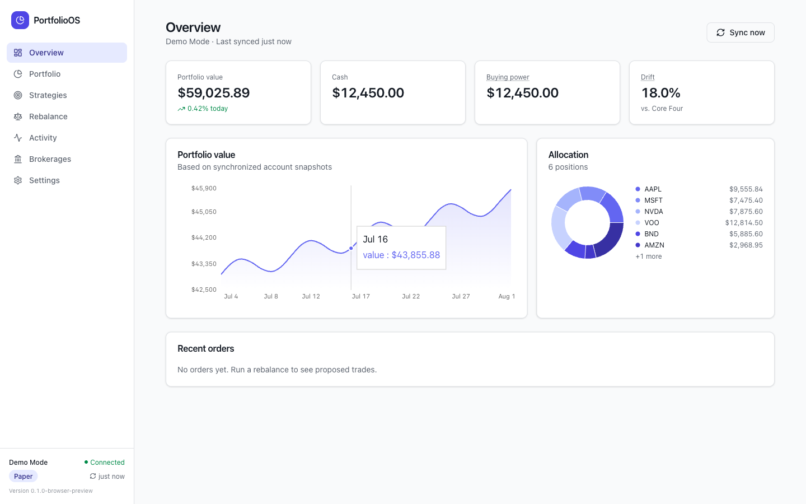
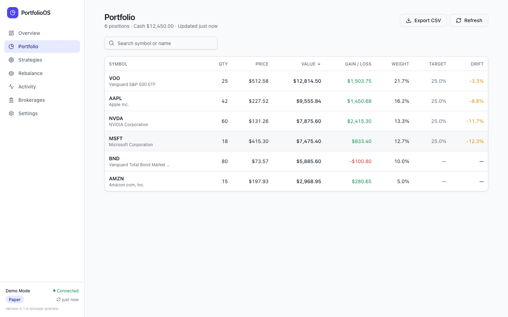
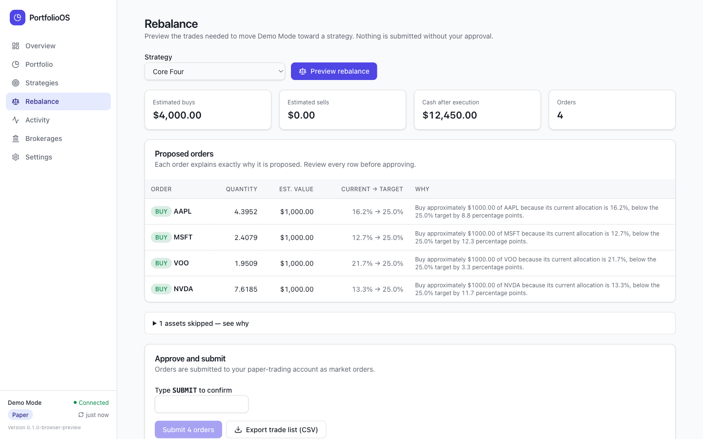

<p align="center">
  
</p>

<h1 align="center">PortfolioOS</h1>

<p align="center">
  <strong>Local-first, open-source investment automation.</strong><br />
  Define transparent strategies, preview exactly what trades they imply, and approve every order yourself — all on your own computer.
</p>

<p align="center">
  <a href="LICENSE"></a>
  
  
</p>



## What it does

PortfolioOS is a desktop app (macOS, Windows, Linux) that helps you run a rules-based portfolio without giving your credentials — or your money — to anyone else:

1. **Connect a brokerage** (Alpaca paper trading, Tradier sandbox, a local IBKR gateway, full demo mode, or a manually tracked portfolio).
2. **Define a strategy** as target weights — equal weight, custom allocation, or an educational momentum example. Strategies are plain YAML you can read, version, export, and share.
3. **Preview the rebalance.** The engine computes exactly which orders would move you toward your targets, explains *why* each order exists, and applies your safety limits.
4. **Approve and submit.** Nothing ever trades without your explicit confirmation. Track fills live and keep a complete local audit trail.

| Portfolio | Rebalance review |
| --- | --- |
|  |  |

## Privacy model

- **Everything runs locally.** The app is a Tauri desktop binary with a Rust backend and a SQLite database in your OS app-data directory.
- **Credentials never leave your machine.** Brokerage API keys are stored in the operating system credential store (macOS Keychain, Windows Credential Manager, Linux Secret Service) — never in SQLite, config files, logs, or the frontend.
- **No telemetry, no accounts, no server.** The only network traffic is between your computer and the brokerage APIs you explicitly connect.

## Security model

- Secrets are masked in the UI after entry and are deleted from the OS credential store when you disconnect.
- The frontend never receives credentials back from the backend.
- Strategy files are declarative YAML — validated, never executed.
- Every order batch requires explicit approval (typed confirmation), and idempotency keys prevent duplicate submissions across retries or crashes.
- Safety rails: maximum order value, maximum batch value, maximum position weight, minimum order size, sell/fractional toggles, market-hours and stale-price warnings, read-only mode, and an emergency stop that blocks all submission and can cancel open orders.

## Supported brokers

| Broker | Status | Capabilities |
| --- | --- | --- |
| **Demo Mode** | ✅ Fully functional | Deterministic simulated portfolio, orders, and fills. No account needed. |
| **Alpaca Paper** | ✅ Functional | Account, positions, orders, market clock, quotes, paper order submission and cancellation, fractional shares. Official REST API, paper endpoint only. |
| **Tradier Sandbox** | 🟡 Beta | Account, positions, quotes (delayed), order preview + sandbox submission (whole shares). |
| **Interactive Brokers** | 🟠 Experimental, read-only | Detects a locally running Client Portal Gateway; reads accounts, balances, positions. No trading in this version. |
| **Manual portfolio** | ✅ Functional | Enter or CSV-import positions, compute drift, export a trade list to place yourself. |

PortfolioOS does not scrape brokerages and will not add unofficial integrations. Version 1 is **paper trading only** — there is no live-money mode.

## Quick start

Prerequisites: [Node.js](https://nodejs.org) ≥ 20, [Rust](https://rustup.rs) ≥ 1.77, and the [Tauri platform prerequisites](https://tauri.app/start/prerequisites/) for your OS.

```bash
git clone https://github.com/your-username/portfolio-os.git
cd portfolio-os
npm install
npm run tauri dev
```

First launch walks you through onboarding. Pick **Demo Mode** to reach a fully populated dashboard in under two minutes — no account required.

## Development

```bash
npm run dev          # frontend only, in a browser with a simulated backend
npm test             # frontend tests (Vitest + Testing Library)
npm run test:rust    # Rust unit + end-to-end tests
npm run lint         # ESLint
npm run typecheck    # TypeScript
npm run format       # Prettier
npm run tauri build  # production installers (.dmg / .msi / .deb / .AppImage)
```

See [DEVELOPMENT.md](DEVELOPMENT.md) for architecture-oriented setup notes and [ARCHITECTURE.md](ARCHITECTURE.md) for how the pieces fit together.

## Strategy files

Strategies are versioned YAML documents (JSON Schema in [docs/strategy.schema.json](docs/strategy.schema.json), full reference in [STRATEGY_SCHEMA.md](STRATEGY_SCHEMA.md)):

```yaml
schema_version: 1
name: Equal Weight Technology
description: Equal allocation across selected technology companies

assets:
  - symbol: AAPL
    target_weight: 0.25
  - symbol: MSFT
    target_weight: 0.25
  - symbol: NVDA
    target_weight: 0.25
  - symbol: GOOGL
    target_weight: 0.25

rebalance:
  method: target_weight
  drift_threshold_percent: 2
  minimum_order_value: 5
  allow_fractional_shares: true

risk_controls:
  maximum_position_weight: 0.30
  maximum_order_value: 1000
  maximum_batch_value: 5000
```

Import and export from the Strategies page. Every change creates a new stored version with an audit entry.

## Risk disclaimer

PortfolioOS is open-source software provided for educational purposes. It is **not** a broker-dealer or an investment adviser, and it does not provide individualized investment advice. Trading involves risk, including loss of principal. You are responsible for reviewing every order before it is submitted. Brokerage data may be delayed or unavailable. Paper-trading results do not represent actual trading performance. See [DISCLAIMER.md](DISCLAIMER.md).

## Contributing

Contributions are welcome — see [CONTRIBUTING.md](CONTRIBUTING.md) and the [broker adapter guide](BROKER_ADAPTERS.md) if you want to add a brokerage with an official API. Please report security issues per [SECURITY.md](SECURITY.md).

## Roadmap

- Limit-order support with configurable pricing
- IBKR order placement via the Client Portal Gateway (behind an explicit opt-in)
- Tax-lot awareness for sell selection
- Scheduled rebalance reminders (never auto-execution)
- Multi-account aggregation
- Localized number/currency formatting

## License

[MIT](LICENSE) © PortfolioOS contributors
